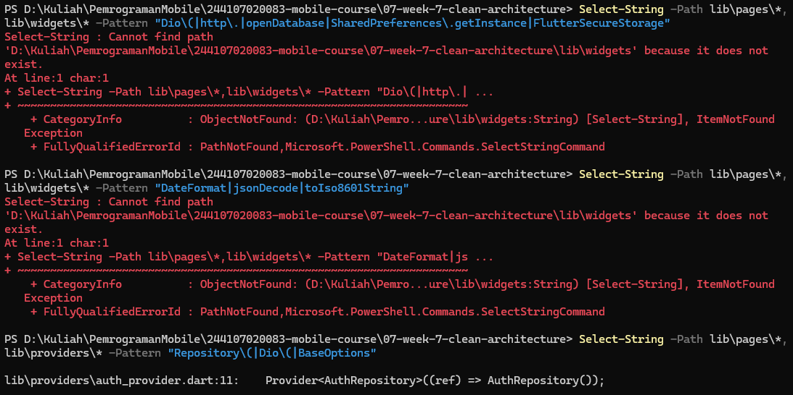
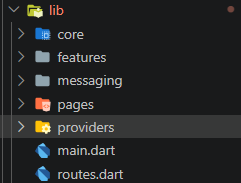
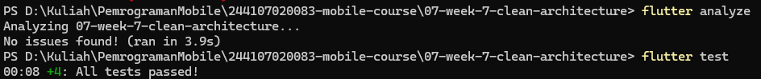
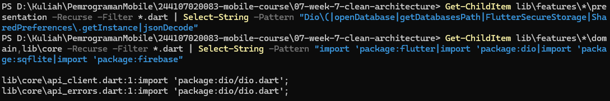
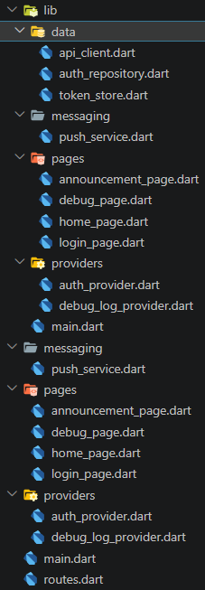
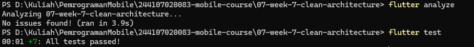

# Flutter Week 7 - Clean Architecture

This project (`campus_notify`, the same project as Week 6) is refactored into a feature-first Clean Architecture
(presentation, domain, data) without adding new features. The goal is to separate business rules from frameworks
(Dio, secure storage, Firebase) so that each layer can be tested and replaced independently, while the app
behaves exactly as before.

## Layer diagram and dependency rule

```
presentation (pages, notifiers, router)
      |
      v  depends on
domain (entities, repository interfaces, use cases, failures)   <- pure Dart
      ^
      |  implemented by
data (models, repository implementations, token store, Firebase, Dio)
```

Dependencies only point inward. `domain` never imports Flutter, Dio, or Firebase. Concrete data classes are
constructed in one place, `lib/app/providers.dart`, and the rest of the app only sees the abstractions.

## Final structure

```
lib/
├── app/
│   ├── providers.dart               # DI composition root (only place that builds *Impl classes)
│   └── push_bootstrap.dart          # startup wiring for push
├── core/                            # pure Dart
│   ├── failures.dart                # Failure, LocalFailure, NetworkFailure, AuthFailure
│   └── format.dart                  # routeFromMessage, truncateToken, formatClock
├── features/
│   ├── auth/
│   │   ├── domain/   entities/auth_session.dart, repositories/auth_repository.dart (interface),
│   │   │             usecases/{login,logout,get_session}.dart
│   │   ├── data/     token_store.dart, auth_remote_data_source.dart (mock), models/auth_session_model.dart,
│   │   │             repositories/auth_repository_impl.dart
│   │   └── presentation/  providers/auth_providers.dart, pages/login_page.dart
│   ├── notifications/
│   │   ├── domain/   repositories/push_repository.dart (interface), usecases/register_device_token.dart
│   │   ├── data/     push_repository_impl.dart, push_service.dart (banners + tap routing glue)
│   │   └── presentation/  providers/{push_providers,debug_log_provider}.dart, pages/debug_page.dart
│   └── announcements/
│       └── presentation/  pages/{home_page,announcement_page}.dart
├── infrastructure/network/          # Dio lives here, not in core/domain
│   ├── api_client.dart
│   └── api_errors.dart
├── main.dart
└── routes.dart
```

### 1. Lab 1 - Audit the old project layers

**Map files to layers**

| File | Current layer | Problem | New destination |
|---|---|---|---|
| `pages/login_page.dart` | presentation | Imports `data/api_errors.dart` directly | `features/auth/presentation/pages/` (shows `Failure.message`) |
| `pages/debug_page.dart` | presentation | Calls `FirebaseMessaging.instance` directly | `features/notifications/presentation/pages/` (reads `fcmTokenProvider`) |
| `pages/home_page.dart`, `announcement_page.dart` | presentation | OK | `features/announcements/presentation/pages/` |
| `main.dart` | presentation + wiring | `_setupPush` posted to `/devices` itself | Stays as router wiring; push startup moved to `app/push_bootstrap.dart` |
| `providers/auth_provider.dart` | presentation (state) + DI | Notifier talked to `TokenStore` and repository directly, DI mixed in | `auth/presentation/providers/auth_providers.dart` + `app/providers.dart` |
| `providers/debug_log_provider.dart` | presentation (state) | Formatted a timestamp itself | `notifications/presentation/providers/`, formatting in `core/format.dart` |
| `data/token_store.dart` | data | OK | `features/auth/data/` |
| `data/api_client.dart` | data | Depended on the concrete repository | `infrastructure/network/`, now depends on the `AuthRepository` interface |
| `data/auth_repository.dart` | data (mixed contract) | Interface and implementation in one class, entity in the data file | Split into entity, interface, mock remote source, model, and `AuthRepositoryImpl` |
| `data/api_errors.dart` | data | Mapped `DioException` to text only | `infrastructure/network/api_errors.dart`, also maps to `Failure` |
| `messaging/push_service.dart` | infrastructure | Global state, no interface | Token/permission/topics behind `PushRepository`; banners and tap routing stay in `notifications/data/push_service.dart` |
| `routes.dart` | presentation | Route constants and a parser together | Constants stay; `routeFromMessage` moved to `core/format.dart` (re-exported) |

**Three classic violations** (Windows PowerShell equivalents of the lab's `rg` commands)

| Search | Hits before | Hits after |
|---|---|---|
| Widgets touching network or storage directly | `debug_page.dart` (`FirebaseMessaging.instance`, 2 hits) | 0 |
| Business logic in `build()` (`DateFormat`, `jsonDecode`, `toIso8601String`) | `debug_log_provider.dart` (1 hit) | 0 |
| Manual instantiation (`Repository(`, `Dio(`, `BaseOptions`) | `auth_provider.dart` (`TokenStore()`, `AuthRepository()`) | 0 in presentation |

Not found by grep but also a violation: `main.dart` performed the `/devices` API call itself.



### 2. Lab 2 - Domain and data per feature

The lab's example is a `notes` feature with SQLite. `campus_notify` has no notes feature and the lab forbids building
a new one, so the same pattern was applied to the code that already existed: `auth` and `notifications`.

- **Pure entity:** `AuthSession` (no mapping, no Flutter import).
- **Failures and contracts:** `core/failures.dart` (`Failure`, `LocalFailure`, `NetworkFailure`, `AuthFailure`), plus the `AuthRepository` and `PushRepository` interfaces. Results use Dart records, for example `({AuthSession? session, Failure? failure})`, so errors do not leak as exceptions.
- **Model and implementation:** `AuthSessionModel` (mapping only), a mock `AuthRemoteDataSource` (ready to swap for Firebase Auth), `AuthRepositoryImpl`, and `PushRepositoryImpl`.
- **Use cases:** `Login`, `Logout`, `GetSession`, and `RegisterDeviceToken`.
- **Also fixed:** the Dio client now has 10-second timeouts and retries a 401 exactly once (a `retried` flag in the request extras).




### 3. Lab 3 - Presentation, DI, and verification

- **DI with Riverpod:** `lib/app/providers.dart` is the single wiring point. Each feature's `presentation/providers` builds use cases and notifiers from the abstractions.
- **Pages only read state:** `DebugPage` watches `fcmTokenProvider` (a stream of the token and every rotation); `LoginPage` shows `Failure.message`.
- **Dependency rule verified** with three checks, all returning zero hits:

```
Get-ChildItem lib\features\*\presentation -Recurse -Filter *.dart | Select-String -Pattern "Dio\(|openDatabase|getDatabasesPath|FlutterSecureStorage|SharedPreferences\.getInstance|jsonDecode"
Get-ChildItem lib\features\*\domain,lib\core -Recurse -Filter *.dart | Select-String -Pattern "import 'package:flutter|import 'package:dio|import 'package:sqflite|import 'package:firebase"
flutter analyze
flutter test
```



## AI Verification Checklist

* **Does the repository interface live in `domain` and the implementation in `data`?**
Yes. `AuthRepository` and `PushRepository` are in `domain/repositories`; `AuthRepositoryImpl` and `PushRepositoryImpl` are in `data`.

* **Is `domain` free of Flutter, Dio, SQLite, and Firebase imports?**
Yes, checked with grep (0 hits in `lib/features/*/domain` and `lib/core`), not by skimming.

* **Did the AI create a use case for every one-line CRUD?**
Partly. `Login`, `Logout`, and `GetSession` only forward one call, which is over-engineering by the lab's definition. `RegisterDeviceToken` combines getting the token, a null check, and sending it, so it is justified. *(Add your final decision: keep or remove the three pass-through use cases, and why.)*

* **Is the entity free of mapping?**
Yes. `AuthSession` has no `toMap/fromMap/toJson`; mapping is only in `AuthSessionModel`.

* **Is DI centralized, with widgets never constructing repositories?**
Yes. `AuthRepositoryImpl(` and `PushRepositoryImpl(` are constructed only in `lib/app/providers.dart`, and the presentation grep returns 0 hits.

* **Your final decision and rationale.**
See `docs/ai-challenge.md`.


### Modifications to AI-Generated Code

- **Moved Dio code out of `core/`.** The AI proposed `core/api_client.dart`, which fails the lab's own grep (no Dio in `core`). It now lives in `lib/infrastructure/network/`.
- **Centralized DI in `lib/app/providers.dart`** instead of one providers file per feature, because auth and notifications share one Dio client.
- **Dropped the `announcements` feature as a full feature.** It has no data layer, so building one would be new code.
- **Kept `push_service.dart` as platform glue** instead of hiding banners and tap routing behind `PushRepository`, which would be a large change for little benefit.
- **Used Dart records** instead of the `fpdart` package for success/failure results.
- Earlier fixes still apply: named arguments for `flutter_local_notifications`, and the foreground-tap navigation (`onRouteRequested`).

## Refactoring and Testing

* **Moved all route strings** into `lib/routes.dart` (`AppRoutes`) so GoRouter and FCM deep links share the same constants.
* **Extracted pure functions** into `lib/core/format.dart`: `routeFromMessage`, `truncateToken`, and `formatClock`.
* **Converted exceptions into `Failure` objects** before they reach the UI, which only receives a `message`.
* **Applied the same pattern to a second feature** (`notifications`), so one feature is not clean while the other is dirty.
* **Tests** (11 written, all without a database, network, or Firebase):
  * `auth_usecases_test.dart`: `Login` failure and success with a fake `AuthRepository`, `GetSession`, and `RegisterDeviceToken` with a fake `PushRepository` (no token, and token sent).
  * `format_test.dart`: route parsing, token truncation, clock formatting.
  * `auth_push_test.dart`: route parsing, token-derived login status, and forced re-login after a failed refresh.




## Reflection

* **Why must the repository interface live in domain, not in data? What breaks if it is reversed?**
  The domain defines what it needs, and the data layer adapts to it. If the interface lived in `data`, the use cases would import the data layer, so the dependency would point outward and domain code could no longer be tested without Dio, Firebase, or secure storage. A fake repository for tests would also have to import the data package.

* **When is a use case truly needed, and when is repository straight to notifier enough?**
  A use case is needed when an operation combines more than one repository or owns a business rule, such as `RegisterDeviceToken`, which fetches the token, handles a missing token, and sends it. For a one-line forward such as `Logout`, the notifier can call the repository directly.

* **What does over-engineering (a use case per one-line CRUD) cost a small team? When is the cost worth it?**
  Every extra layer adds a file, a provider, and a test for no new behavior, and it makes the code slower to read and change. It is worth it once the operation gains rules (validation, sorting, sync), because the use case is then the natural place for them and the tests already exist.

* **Which part of the AI proposal did you reject or simplify, and why?**
  I changed the AI's `core/api_client.dart` and `core/providers.dart` because they violated the dependency checks, moved DI to a single composition root, rejected `fpdart` in favor of records, and did not build a full `announcements` feature because it had no data layer to refactor.

*(These answers are drafts. Rewrite them in your own words before submitting.)*
