# Flutter Week 8 - Mid-Project Review and Code Review

This project documents a mid-project review of the work from Weeks 5–7, focusing
on Git hygiene, code review, static analysis, refactoring, testing, and error
handling.

## Project Stages

### 1. Practical 1 - Branch and commit hygiene

Started the audit in the course repository by checking the latest 15 commits,
available branches, and working-tree status.
- At the initial audit, the current branch was `main`, and the history showed
  `main` at the latest commit.
- The initial branch listing showed only `main` and `origin/main`; a `develop`
  branch was not present yet.
- The log includes the vague message `Fifth Week : idk wat hapen here, i hate
  ai`, one example of a message to rewrite with a clear scope and reason.
- `git status` shows the Week 8 folder as untracked. This is the new assignment
  work, so it should be reviewed and committed rather than ignored.
- Created `develop` from `main` and pushed it to `origin`; then created
  `feat/notes-validation` from `develop`.
- The Week 5 notes screen already trims and rejects blank titles, while its
  widget test is still the default counter smoke test.
- Drafted the three-message review checklist in
  [`docs/review-checklist.md`](./docs/review-checklist.md). The checklist
  was committed and pushed on `feat/notes-validation` as
  `4986c24` (`docs(review): add commit message checklist`).

**Screenshots:**

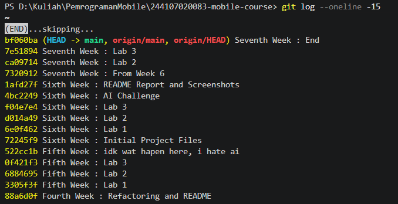
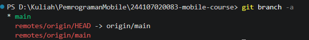
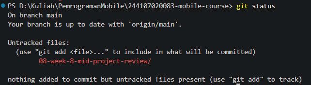
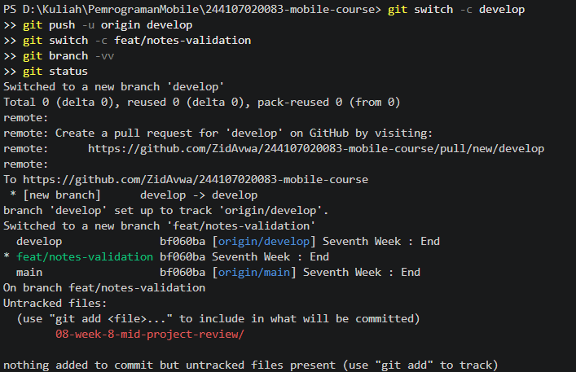
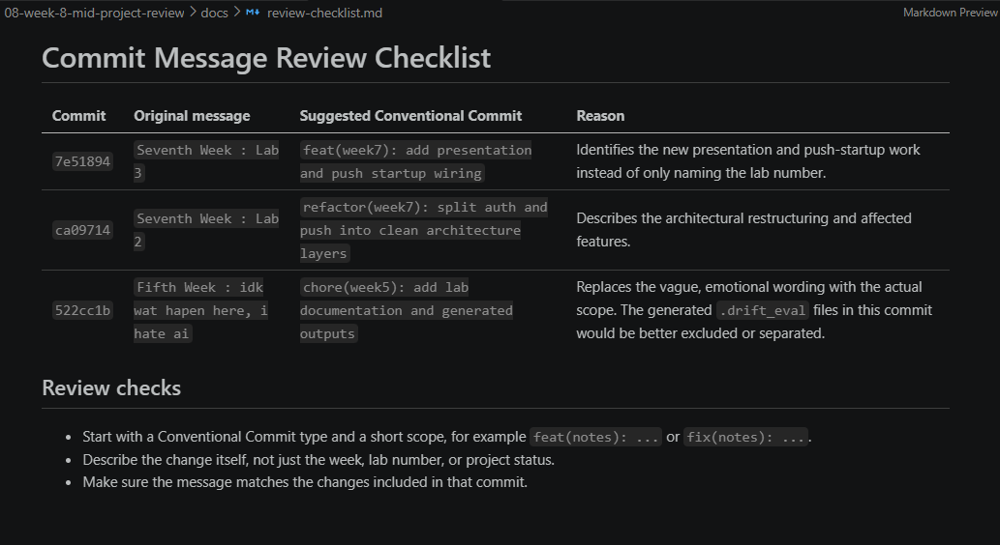
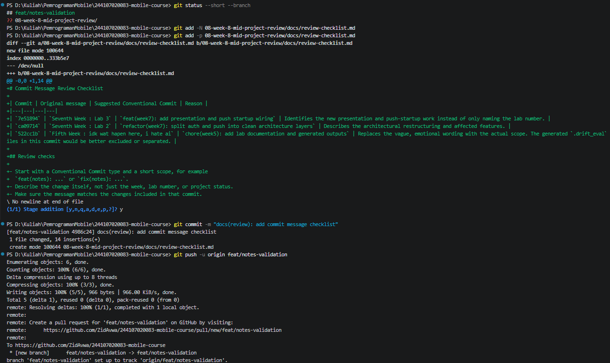

### 2. Practical 2 - Pull request and peer review

Prepared the notes-title validation change and its focused widget test on the
`feat/notes-validation` branch.
- The New Note form now shows `Title is required` and remains open for empty or
  whitespace-only titles.
- A valid title is trimmed before the note is saved.
- `test/validate_note_test.dart` verifies blank-title rejection, no repository
  save on invalid input, and saving a trimmed title.
- The focused test passes, and analysis of the changed Dart files reports no
  issues.
- Validation is implemented in the presentation form because the Week 5
  project has no use-case layer.
- Committed the implementation and test as
  `c0d7ca1` (`feat(notes): validate titles and add widget test`) and pushed it
  to `origin/feat/notes-validation`.
- Compared `feat/notes-validation` with `develop`; GitHub reports that the
  branches can merge automatically. The comparison contains the notes change
  and the earlier checklist commit.
- Opened pull request #1 from `feat/notes-validation` into `develop`. It
  contained two commits and three changed files, and was merged into `develop`.
- Reviewed a classmate's PR and left feedback covering correctness, architecture,
  test coverage, and readability. The feedback was left as a conversation
  comment; a formal **Approve** or **Request changes** review was skipped.

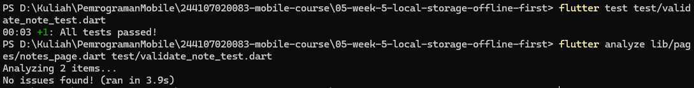
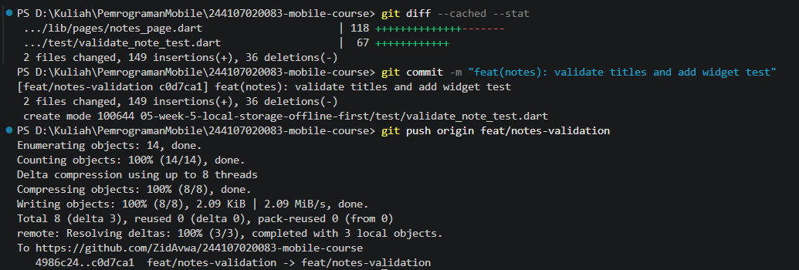
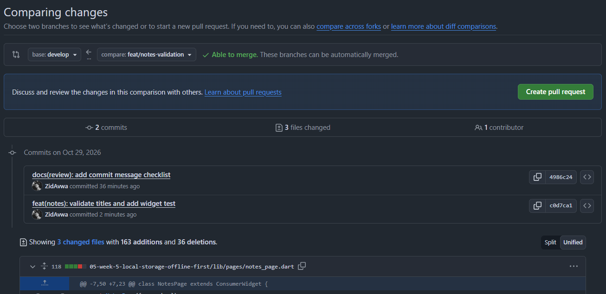
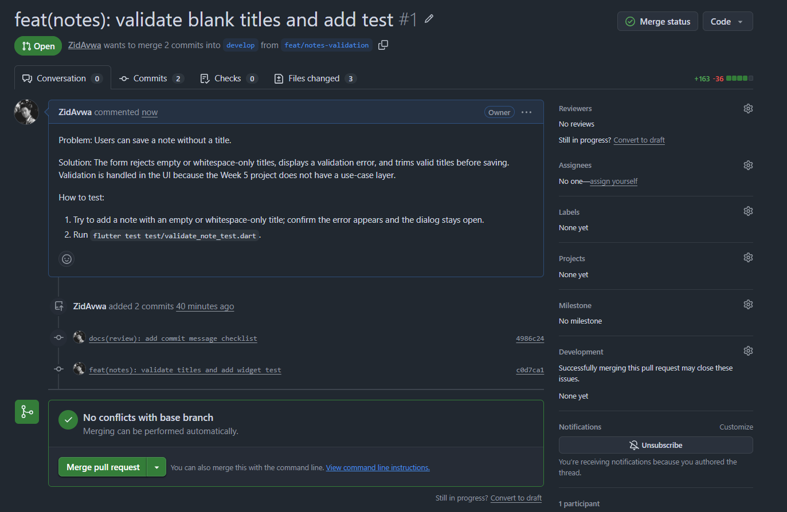
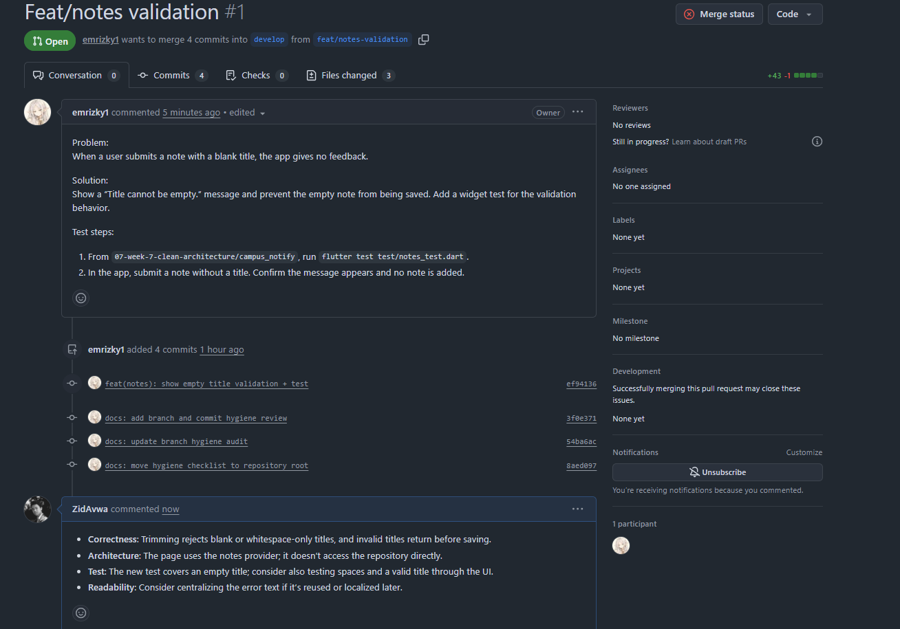

### 3. Lab 3 - Static analysis and mid-project review

Ran the three machine checks in the Week 7 Clean Architecture project.
- `flutter analyze` reported no issues.
- `dart format --set-exit-if-changed .` formatted 39 Dart files, with 18 files
  changed in the working tree. Those formatting-only working-tree changes were
  later reverted.
- `flutter test` passed all tests.
- Added a GitHub Actions workflow that runs `flutter pub get`, `flutter analyze`,
  and `flutter test` for pull requests targeting `develop`, using the Week 7
  project as its working directory.
- The readiness checks confirmed the feature-first folders and found no direct
  infrastructure dependencies in the presentation layer.
- The domain/core import check found two Dio imports in `lib/core`
  (`api_client.dart` and `api_errors.dart`), so the dependency boundary is not
  fully clean yet.
- **Readiness assessment:** partially ready. The analysis and tests pass, and
  the feature structure is in place; the remaining Dio imports in `core` should
  be addressed before claiming the dependency rule is fully satisfied. The
  workflow has been added, but no GitHub Actions run has been verified yet.

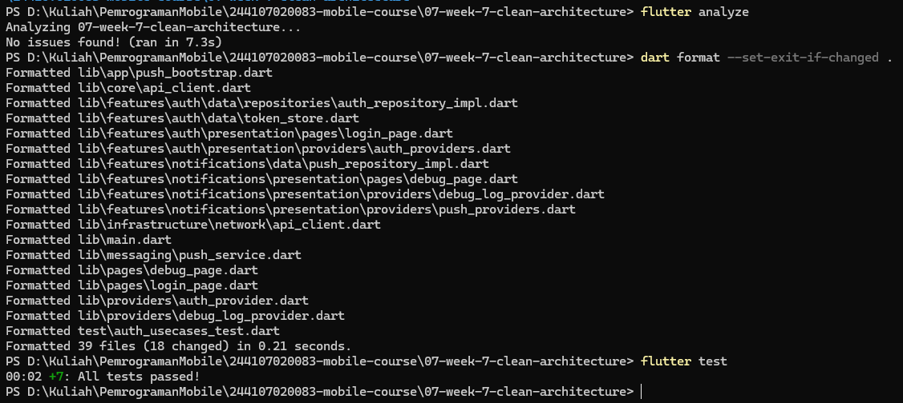
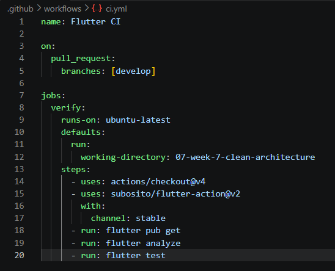
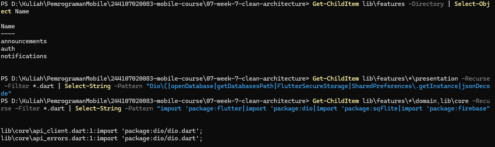

### 4. AI Challenge - Verify the review, not just the AI

Asked an AI assistant to review merged PR #1 and verified its proposals against
the actual Week 5 changes.
- Accepted three findings as suggestions: missing cancel/error test cases,
  coupling the test fake to the concrete SQLite repository, and missing
  post-dialog mounted/error handling.
- Rejected the domain-layer blocker because this PR targets the Week 5 project,
  which has no domain layer; adding one is outside the focused validation task.
- Rejected the CI blocker as a PR finding because the workflow is a separate
  Lab 3 deliverable and was not part of PR #1.
- The focused widget test passed, and targeted analysis reported no issues.
- No suggested code fixes were applied.

The prompt, raw AI response capture, proposal-vs-decision table, and
verification evidence are recorded in
[`docs/ai-review-vs-decision.md`](./docs/ai-review-vs-decision.md).

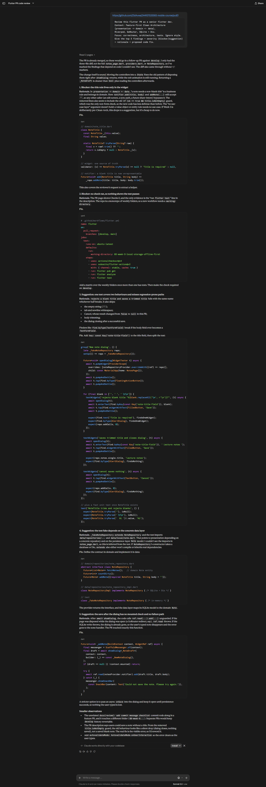
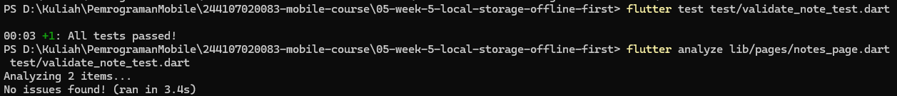

## Reflection

- **What separates a blind LGTM from a responsible approve? What does it risk
  for the team?** A responsible approval comes after checking the actual diff,
  considering correctness and tests, and verifying important claims. A blind
  LGTM skips that work and can let bugs or design problems reach the shared
  branch, increasing the cost of fixing them and reducing trust in reviews.
- **When must a comment be request changes, and when is a suggestion enough?**
  Request changes when there is a concrete blocker such as incorrect behavior,
  a broken requirement, or a serious reliability issue that should be fixed
  before merging. Use a suggestion for a non-blocking improvement that can be
  considered without holding up the change.
- **Which part of the AI review did you reject or simplify, and why?** I
  rejected the claim that title validation had to be moved into a domain layer:
  the reviewed PR is in the Week 5 project, which has no domain layer, and
  introducing one was outside the task. I also rejected the CI complaint as a
  PR finding because the workflow is a separate Lab 3 change, not part of PR
  #1. I kept the other points as suggestions rather than blockers.
- **One concrete thing fixed after peer review—what was its impact?** I did not
  make a code change in response to the peer-review comment; I left feedback
  on a classmate's PR and did not apply changes to their code. Separately, my
  Week 5 change rejects blank note titles and trims valid ones, preventing
  empty-title notes and inconsistent leading/trailing whitespace.