# Flutter Week 9 - AI-Assisted Development

This project uses the existing Week 7 `campus_notify` app for the Week 9
AI-assisted development labs. The work adapts the lab's notes-search example to
the announcements feature already in this app; it does not start a new project
or add a notes feature.

## Lab 1 - Prompt and context engineering

The lab example describes notes search, but this project has an announcements
screen and no notes feature. The prompt was adapted to the app that actually
exists: search announcement titles, keep detail navigation working, and avoid
adding a database, dependencies, or unrelated architecture.

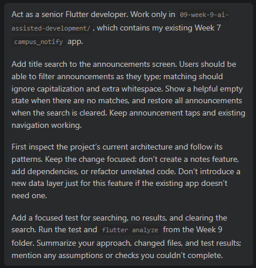
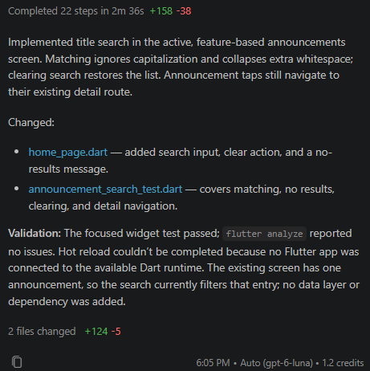

## Lab 2 - Generate and verify search

Added title search to
`lib/features/announcements/presentation/pages/home_page.dart`.

- Search is case-insensitive and ignores leading, trailing, and repeated
  whitespace.
- A clear action restores the full list.
- A no-results message appears when nothing matches.
- Tapping a result still opens its announcement detail route.
- At the time of this lab, the list contained one hardcoded announcement; no
  repository or backend was added.

`test/announcement_search_test.dart` checks matching with mixed case and extra
spaces, the no-results state, clearing the query, and detail navigation.

Validation run from this project directory:

```powershell
flutter test test/announcement_search_test.dart
flutter analyze
```

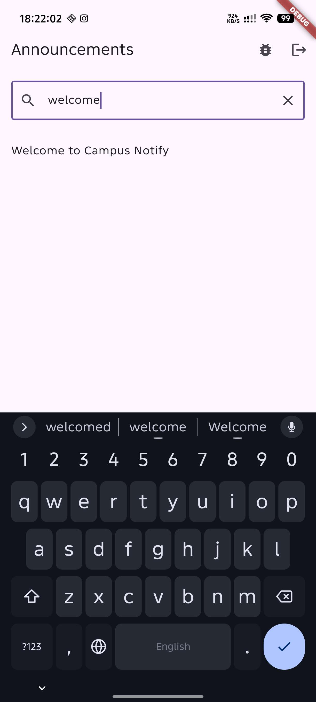
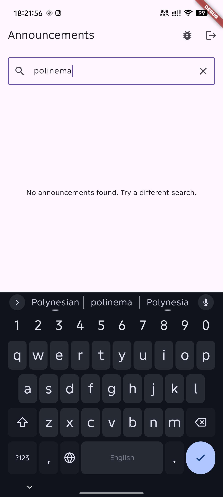

## Lab 3 - Debug and refactor

Checked the announcement search behavior before refactoring. The existing
focused test passed for case-insensitive matching, repeated whitespace, no
results, clearing the query, and detail navigation, so no reproducible search
bug was found. Rather than inventing a bug or making an unnecessary behavior
change, the search logic was refactored for clearer separation of concerns:

- Moved title matching and query normalization into the pure
  `SearchAnnouncements` use case.
- Moved search-query state into a Riverpod `Notifier`.
- Kept the announcement list in memory; no repository or data layer was added.

The focused search test, full test suite (9 tests), `flutter analyze`, and
formatting check for the changed Dart files passed. A workspace-wide formatter
check could not complete because of a missing generated Gradle path under
`build/`. Hot restart was unavailable because no Flutter app was connected.

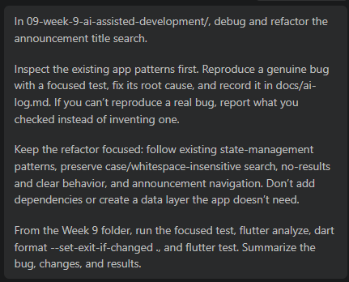
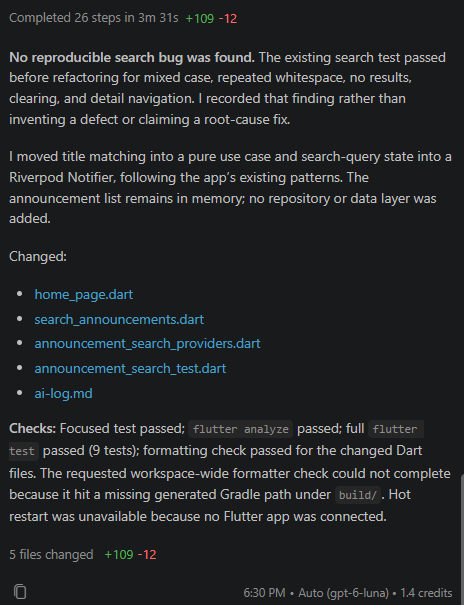
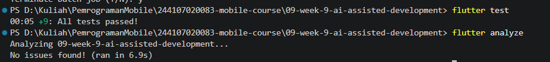

## AI Challenge - Review the search feature

The review prompt asked for three correctness, architecture, or test findings,
with severity and reasoning. The findings and decisions are documented below.

| AI finding | Review decision | Evidence / follow-up |
|---|---|---|
| Search query state can outlive the page's text controller. | **Accepted and fixed below.** | The query now uses Riverpod's auto-dispose notifier provider. The route-away-and-reopen widget test confirms the field is blank and the full list is restored. |
| Search uses a hardcoded announcement instead of SQLite/Dio data. | **Reject as a defect; document as a limitation.** | This Week 7-derived app has no announcement repository or API to connect to, and the feature is meant to demonstrate local search. Adding SQLite/Dio or inventing a backend would exceed the feature scope. |
| Widget test does not verify filtering among multiple visible announcements. | **Accepted and tested below.** | The widget uses an overrideable in-memory announcement provider, and its test verifies filtering three fixture items. |

### Verification

The lifecycle and multi-item test follow-ups are completed and tested in the
section below.

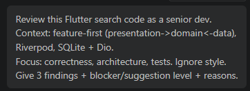
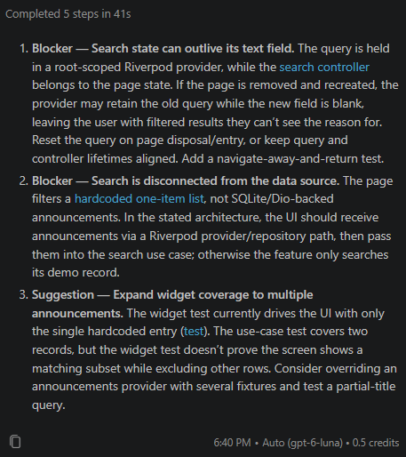

## Refactoring, testing, and common errors

- Made search-query state auto-dispose, so reopening the page clears the field
  and restores the full list.
- Added a test-only provider override and widget coverage for filtering three
  announcements and reopening the page.
- Kept title matching in the pure domain use case and announcements in memory;
  no database, backend, or dependency was added.
- **Accepted and fixed:** stale search state; verified by the page-reopen test.
- **Rejected:** adding SQLite/Dio. This app has no announcement API or
  repository, so that would add unrelated infrastructure.

Validation from the Week 9 folder: focused search tests (3 passed), full test
suite (10 passed), `flutter analyze` (no issues), and formatting check (3 files,
0 changed).

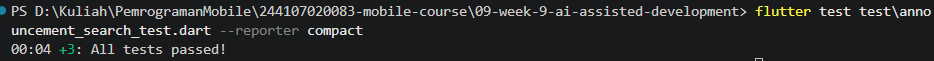
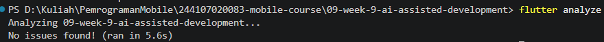

