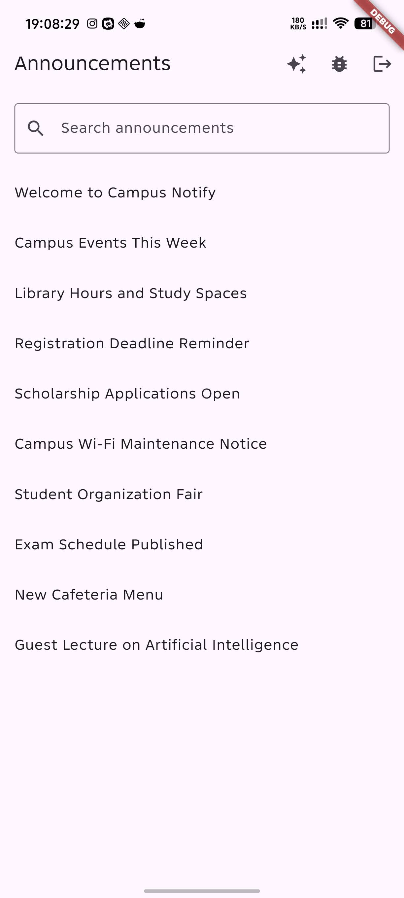
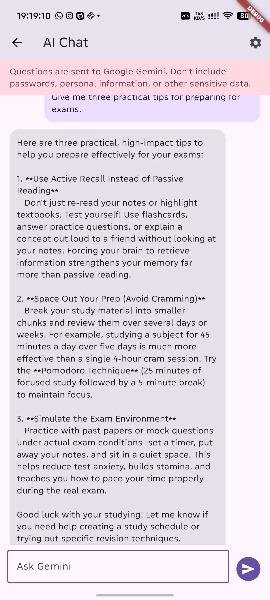
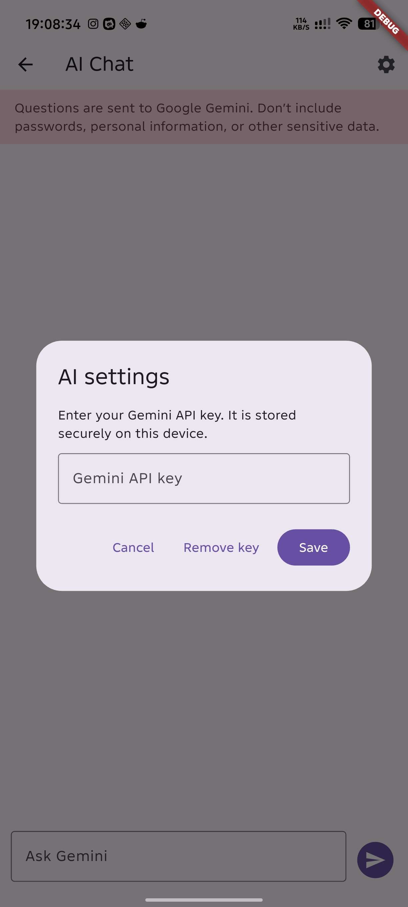
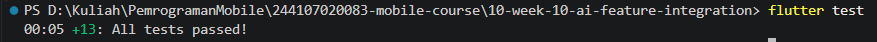
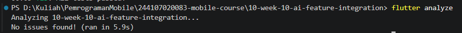

# Flutter Week 10 - AI Feature Integration

This project adds a Gemini chat feature to the existing `campus_notify` app.
Students can open the chat from Announcements, enter their own API key, and
receive a streamed answer to a question.

## Project Stages

### 1. Practical - Chat interface with AI

- Added **Ask AI** to the Announcements screen and registered the `/ai-chat`
  route.

  

- Added a chat screen with message bubbles, a send action, and a loading
  indicator while Gemini streams its answer.

  

- Added AI settings so the user can save or remove their Gemini API key.
- `AiApiKeyStore` stores the key using `flutter_secure_storage`; no key is
  hardcoded in the app.

  

- `GeminiAiChatService` sends each new question to Gemini 3.6 Flash. Earlier
  chat messages are not included in subsequent requests.
- The project reuses its existing Dio and Flutter Secure Storage dependencies.
- The Gemini system instruction, sample user prompt, and initial-output
  evidence are tracked in [`docs/ai-log.md`](./docs/ai-log.md).

### 2. Privacy, cost, and error handling

| Risk | Mitigation |
|---|---|
| A Gemini API key could be exposed in source code or screenshots. | The app asks the user for a key at runtime and stores it with `flutter_secure_storage`. Keep real keys out of source control and screenshots. A key in a client app can still be extracted from a compromised device; a production app should proxy AI requests through a protected backend. |
| A user could send sensitive information to the AI provider. | The chat screen warns users not to submit passwords, personal information, or other sensitive data. Only the current question is sent; the app does not attach previous messages. |
| Repeated requests can use quota or incur API charges. | Requests are sent only when the user submits a question. There are no automatic retries or background requests. Monitor and configure API quotas in Google AI Studio. |
| Network, key, or service errors can interrupt a response. | The UI reports invalid-key, quota, connectivity, failed-request, and empty-response errors. The user can correct the key or retry after the problem is resolved. |

Questions are sent to Google's Gemini API. Do not use this feature to send
confidential or personally identifying information.

### 3. Validation

Run from this project directory:

```powershell
flutter test
flutter analyze
```

- `flutter test` — all 13 tests passed, including the AI chat widget tests.

  

- `flutter analyze` — no issues found.

  

The AI chat tests verify that a submitted question is trimmed, streamed answer
chunks appear in the conversation, and an API key can be saved through settings.

## Reflection

- **Which AI feature did you integrate and why?** I integrated a Gemini chat
  because it provides a direct, interactive way for a student to ask a question
  and receive a response in the app.
- **How do you protect user privacy when using an AI API?** The API key is
  stored with secure storage rather than in source code. The app sends only the
  submitted question, warns against sharing sensitive data, and does not add
  prior chat messages to later requests. A production deployment should keep
  provider credentials behind a backend service.
- **What fallback do you provide if the AI service errors?** The chat shows an
  error message for key, quota, network, and response failures, while retaining
  the conversation so the user can retry.
- **What did you learn about AI feature UX on mobile?** Streaming makes it
  clearer that a response is in progress; secure key setup, a visible loading
  state, and actionable errors also matter for a usable chat experience.
