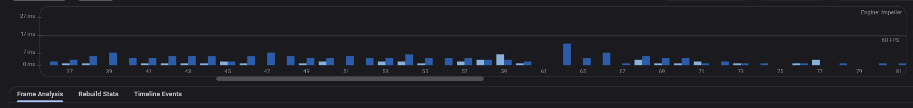
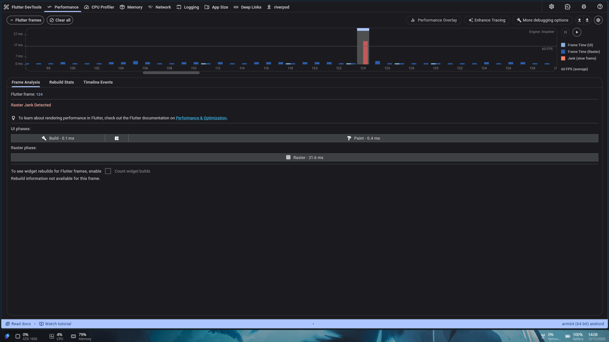
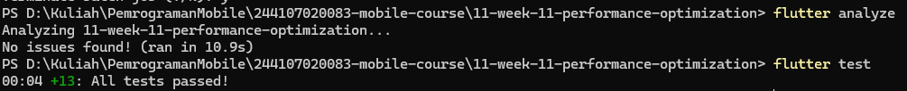
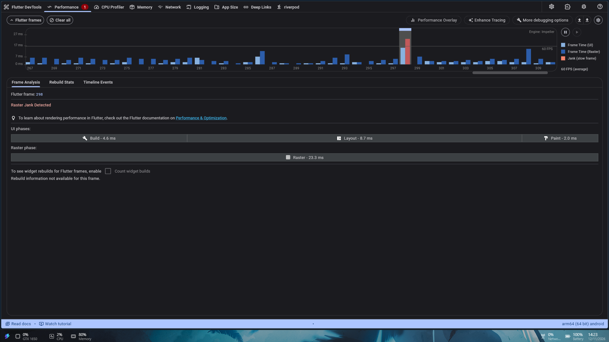
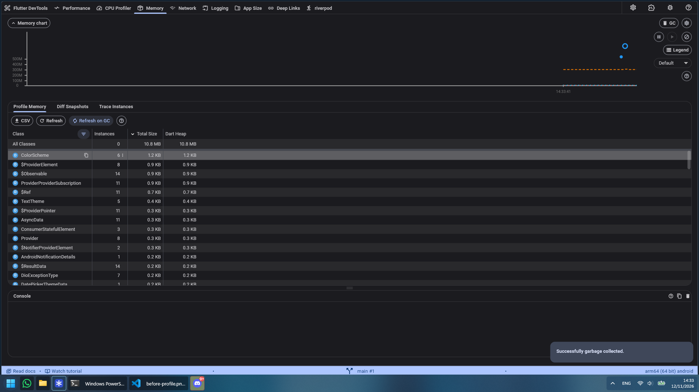

# Flutter Week 11 - Performance Optimization

This project profiles and optimizes the existing `campus_notify` Flutter app.
It records baseline and post-change DevTools evidence, applies focused UI and
search-path optimizations, and documents the limits of the measurements.

## Project Stages

### 1. Baseline profiling

Captured the app on an Android phone in profile mode using Flutter DevTools.

- `baseline-raster-jank-frame-124.png` shows a raster jank frame at 21.6 ms,
  above the approximately 16.7 ms budget for 60 FPS.
- The screenshot does not identify which screen or action produced the frame.
- Other selected baseline frames are recorded in the performance findings.




Detailed evidence is in
[`docs/performance-findings.md`](./docs/performance-findings.md).

### 2. Optimizations

- Changed the announcement results to `ListView.builder`, which builds list
  rows lazily.
- Split the search field and results into separate Riverpod consumer widgets,
  so updating the search no longer rebuilds the Home page and its AppBar.
- Reused the compiled whitespace-matching regular expression in search
  normalization.

The announcement list currently contains ten in-memory items, so the lazy-list
benefit for this sample is limited. The captured jank is in rasterization; the
screenshots do not identify its cause, so these changes are not claimed as a
specific fix for that frame.

### 3. Verification

Run these commands from this project directory:

```powershell
flutter analyze
flutter test
```

The recorded validation reports no analyzer issues and all 13 tests passing.



The post-change capture includes both selected frames without jank and a
raster-janky frame at 23.3 ms. Because the before and after captures do not
identify the same user action, they do not establish an overall performance
improvement.



### 4. Memory check

Compared the DevTools Profile Memory tables before and after repeating
Home → announcement → Back navigation. Both screenshots show 10.8 MB total and
the visible class counts are unchanged. This check found no visible evidence
of a leak, but the captures are not heap snapshots or a Diff Snapshots result.




## Reflection

- The selected baseline frame missed the 60 FPS budget during rasterization.
  The available screenshot does not show the screen or the content being
  rasterized, so identifying the root cause requires another recording with
  the interaction noted.
- The optimizations improve list construction and narrow search-triggered
  rebuilds. The ten-item sample is small, so a larger dataset or repeated
  profiling would be needed to measure their impact.
- Verification used analyzer and automated tests, plus before/after DevTools
  captures. The captures are not directly comparable because they do not record
  matching actions; no performance improvement is claimed from them.
- Optimization should be guided by repeatable profiling evidence. A single
  slow frame is useful evidence of a symptom, but not enough to determine its
  cause.