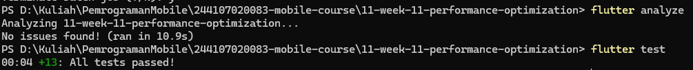

# Performance Findings

## Test setup

- Device/mode: Android phone, Flutter profile mode.
- Tool: Flutter DevTools Performance and Memory tabs.
- The screenshots do not document the exact user action during each selected
  frame. Before/after frame measurements should therefore not be treated as a
  controlled comparison.
- Raw DevTools exports: [`dart_devtools_before.json`](./dart_devtools_before.json)
  and [`dart_devtools_after.json`](./dart_devtools_after.json).

## Baseline profile

### Raster jank: frame 124

- Evidence: [`baseline-raster-jank-frame-124.png`](../screenshots/baseline-raster-jank-frame-124.png)
  reports **Raster Jank Detected**. Raster took **21.6 ms**, above the
  approximately **16.7 ms** frame budget for 60 FPS. UI Build took 0.1 ms and
  Paint took 0.4 ms.
- Impact: This frame missed the 60 FPS budget and may appear as a brief
  stutter.
- Context limitation: The screenshot does not identify the screen or action,
  or the content being rasterized, so it does not establish a root cause.

### Other selected baseline frames

- [`baseline-frame-386-no-jank.png`](../screenshots/baseline-frame-386-no-jank.png):
  no jank; Build 3.0 ms, Layout 3.3 ms, Paint 2.3 ms, Raster 8.6 ms.
- [`baseline-frame-398-no-jank.png`](../screenshots/baseline-frame-398-no-jank.png):
  no jank; Build 3.2 ms, Layout 6.6 ms, Paint 1.9 ms, Raster 6.9 ms.

These are individual selected frames and do not rule out jank elsewhere in the
recording.

## Optimizations applied

1. Replaced the eager announcement list with `ListView.builder` to construct
   rows lazily.
2. Split the search field and results into separate Riverpod consumer widgets,
   reducing rebuild scope when the search query changes.
3. Reused the compiled whitespace regular expression during query
   normalization.

The sample currently has ten in-memory announcements, so the expected benefit
of lazy construction is limited for this dataset. These changes target list
construction and search-triggered work; the baseline jank was raster-phase
work, whose cause is not visible in the capture.

## Post-change profile

- [`after-frame-286-no-jank.png`](../screenshots/after-frame-286-no-jank.png):
  selected frame reports no jank; Raster 13.0 ms.
- [`after-raster-jank-frame-298.png`](../screenshots/after-raster-jank-frame-298.png):
  **Raster Jank Detected**; Raster 23.3 ms. UI Build 4.6 ms, Layout 8.7 ms,
  Paint 2.0 ms.
- [`after-frame-308-no-jank.png`](../screenshots/after-frame-308-no-jank.png):
  selected frame reports no jank; Raster 14.8 ms.

The post-change recording still contains a janky frame. Although the selected
baseline jank was 21.6 ms and the post-change jank was 23.3 ms, the screenshots
do not establish that the same interaction was measured under comparable
conditions. They cannot establish whether overall performance improved or
worsened.

## Memory check

- Compared [`memory-before-navigation.png`](../screenshots/memory-before-navigation.png)
  and [`memory-after-navigation.png`](../screenshots/memory-after-navigation.png)
  after repeating Home → announcement → Back navigation.
- Both Profile Memory tables show **10.8 MB** total. The visible counts are
  unchanged, including `$ProviderElement` (8), `$Observable` (14), and
  `ConsumerStatefulElement` (3).
- Conclusion: The displayed data contains no evidence of an accumulating
  object in this test.
- Limitation: These are Profile Memory table captures, not saved heap
  snapshots or a Diff Snapshots result. This limited comparison is not proof
  that the app has no memory leaks.

## Validation

The saved validation screenshot reports `flutter analyze` with no issues and
all 13 tests passing:

## Follow-up

To evaluate the jank fix, record a new before/after run using the same device,
profile mode, and repeatable screen interaction. Note the action at the time of
each slow frame and inspect its UI and raster phases before choosing a targeted
optimization.
