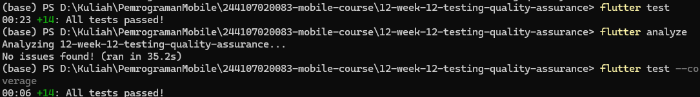
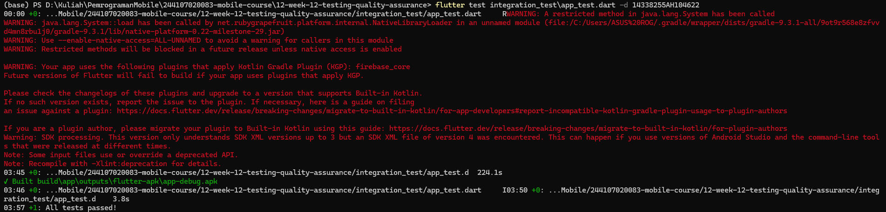

# Flutter Week 12 - Testing and Quality Assurance

This project adds a focused test suite for `campus_notify`. The main feature
under test is announcement search and opening announcement details; the app
flow also checks the login redirect needed to reach those screens.

## Project Stages

### 1. Test strategy

The scenarios cover a successful search and navigation, invalid login input,
an unmatched search, and empty or whitespace-normalized queries. Tests replace
authentication, push-token, and AI dependencies with fakes so results do not
depend on a live server or API key.

### 2. Unit tests and edge cases

`test/announcement_search_test.dart` groups the search logic checks:

- Mixed-case queries with extra leading, trailing, and repeated whitespace
  still match the expected announcement.
- An empty or whitespace-only query returns the full list.
- A query with no match returns an empty result.

`test/auth_usecases_test.dart` groups login/session and push-token use cases,
including invalid login, successful login, missing token, and successful token
registration. `test/format_test.dart` covers route defaults, token truncation,
and clock formatting.

### 3. Async code and dependencies

The auth and push use cases use fake repositories for success and failure
results. `test/ai_chat_test.dart` uses a controlled stream for the async chat
widget and a recording Dio adapter for the Gemini request. These tests avoid
network access and verify that request content is sent as expected.

### 4. Widget tests

The announcement widget tests check the initial list, filtering, no-results
message, clearing the query, restoring the list, and opening details. The AI
chat widget tests check loading, a streamed answer, and saving an API key.
`test/app_flow_test.dart` also verifies that invalid login stays on the login
screen and displays an error before a successful login proceeds.

### 5. Integration and regression testing

`integration_test/app_test.dart` uses the real app router and screens with a
fake auth repository. It covers invalid login, successful login, searching for
an announcement, and opening its details. The same scenario runs locally as a
widget test. The integration test also passed on a connected Android device.

### 6. Lab: test the announcement flow

| Scenario | Expected behavior | Test |
| --- | --- | --- |
| Invalid email | Show the login error and remain on login | `test/app_flow_test.dart` |
| Valid login, search, open result | Redirect to announcements and show the selected detail | `test/app_flow_test.dart`, `integration_test/app_test.dart` |
| Empty, whitespace, or unmatched query | Show all announcements or the no-results message as appropriate | `test/announcement_search_test.dart` |

The app-flow test checks the router, auth state, and screens together. The
device run verifies that flow through the Android integration-test runner.

### 7. Coverage, assignment, and reflection

Run these commands from this project directory:

```powershell
flutter test
flutter analyze
flutter test --coverage
flutter devices
flutter test integration_test/app_test.dart -d <device_id>
```

**Local results:** `flutter test` passed all 14 tests, `flutter analyze`
reported no issues, and `flutter test --coverage` passed all 14 tests. These
results include the local app-flow widget test. The device command
`flutter test integration_test/app_test.dart -d <device_id>` also passed its
integration test on Android. Coverage is useful for finding unexecuted code;
it does not prove that the important behavior and edge cases were asserted.

**Unresolved finding:** the Android build emitted Gradle/plugin and Android SDK
XML version warnings, although it built successfully and the integration test
passed. These warnings were not investigated in this testing task.

**Reflection**

- An invalid login being treated as authenticated would be easy to miss without
  an explicit failure assertion; the flow test verifies the error and route.
- The fake auth repository makes success and failure predictable and avoids
  live credentials or network changes. The AI chat fake stream makes loading
  and completion deterministic.
- Widget tests show the visible states and interactions. The app-flow scenario
  checks that auth redirect, search, and detail navigation work together, but
  the Android integration test confirms the flow on a device.

## Evidence to Capture

Save screenshots in `screenshots/`:

- `test-results.png` - terminal output showing `flutter test` passed and
  `flutter analyze` reported no issues.
- `integration-test.png` - terminal output from the device integration command,
  showing the integration test passed.
- `announcement-details.png` - optional screenshot of the selected detail
  screen on the emulator or phone.






