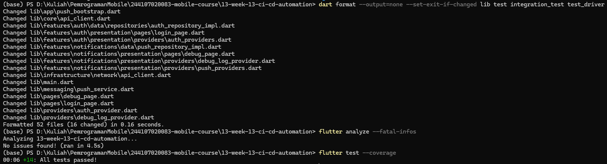
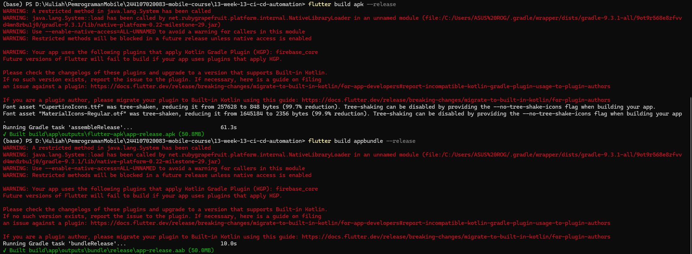
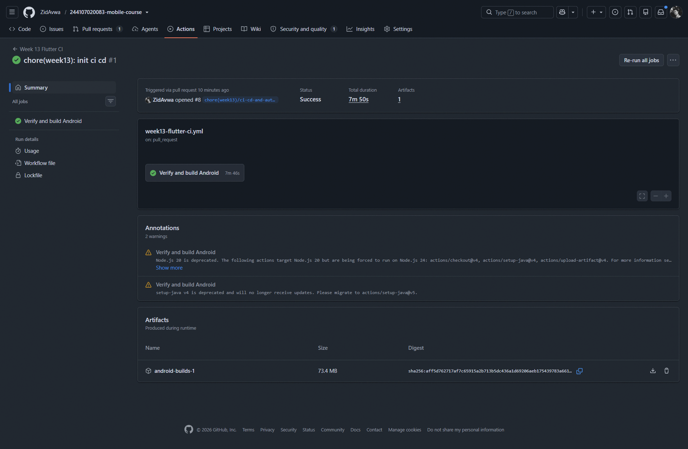

# Flutter Week 13 - CI/CD and Automation

This project adds a GitHub Actions workflow for the Week 13 Flutter app. It
automates formatting checks, static analysis, tests, and Android release
artifact builds so results can be reviewed for pull requests and pushes to the
`develop` and `main` branches.

## Project Stages

### 1. CI/CD workflow

The workflow is at the repository root in
`.github/workflows/week13-flutter-ci.yml`. GitHub only discovers workflow files
from the repository-root `.github/workflows/` directory; the workflow runs its
commands from this Week 13 project folder.

For pull requests targeting `develop` or `main` and pushes to either branch
that change this project (or the workflow), it:

1. Checks out the repository and configures Java 17 and Flutter 3.47.2 stable.
2. Gets dependencies and checks formatting for unit/widget tests, the
   integration test, and test driver.
3. Runs `flutter analyze --fatal-infos` and `flutter test --coverage`.
4. Builds a release APK and Android App Bundle (AAB).
5. Uploads both files as the `android-builds-<run number>` artifact for seven
   days.

The workflow can also be started manually with `workflow_dispatch`. It has
read-only repository permissions and cancels an older run when a newer run for
the same ref starts.

### 2. Run the checks locally

From PowerShell:

```powershell
flutter pub get
dart format --output=none --set-exit-if-changed test integration_test test_driver
flutter analyze --fatal-infos
flutter test --coverage
```

The format gate covers test and integration-test code. The existing app `lib/`
files were left untouched because they are outside this Week 13 change; they
are not covered by this formatting gate. A test failure or analyzer/format
failure makes the workflow fail before it builds or uploads artifacts.

### 3. APK and AAB artifacts

After all checks pass, the workflow runs:

```powershell
flutter build apk --release
flutter build appbundle --release
```

Expected output paths:

- `build/app/outputs/flutter-apk/app-release.apk`
- `build/app/outputs/bundle/release/app-release.aab`

To download them, open the repository on GitHub, select **Actions**, open the
successful **Week 13 Flutter CI** run, and download
`android-builds-<run number>` under **Artifacts**.

**Important signing limitation:** `android/app/build.gradle.kts` currently
signs the release variant with the debug signing configuration. These builds
are for CI evidence and testing only; they are not production-signed and must
not be published to Google Play. A future release workflow should use a
protected signing key stored as a GitHub Actions secret and must not expose it
to pull-request builds.

### 4. Versions, secrets, and security

The current version in `pubspec.yaml` is `1.0.0+1`: `1.0.0` is the semantic
version and `1` is the Android build number. For a new release, increment the
appropriate semantic version component and increase the build number. Tag a
release only after the relevant workflow checks pass.

This CI workflow needs no repository write permission or application secrets.
Do not put passwords, API tokens, or signing keys in source code or pass
secrets using `--dart-define`; values compiled into an app can be extracted.
The workflow does not publish to the Play Store.

### 5. Running and evaluating the pipeline

Push this branch and open a pull request targeting `develop`. In **Actions**,
open the run for that pull request and review each step. Confirm the formatting,
analysis, and test steps pass and that the APK and AAB are listed in the
artifact. After the feature PR is merged into `develop`, open a second pull
request from `develop` to `main` and review its Actions run too.

For a controlled failure check, make a temporary change to an existing test
assertion on a separate branch, commit and push that branch, and open a
temporary pull request targeting `develop`. Confirm the Actions run fails at the
test step, then close the temporary pull request and delete its branch. Keep
this experiment separate from the real Week 13 pull request; never merge the
failing test or disable the check to make CI green.

Record the successful run's commit SHA and artifact name. If a build fails,
inspect the first failing step and its complete log, then rerun the corrected
commit. A successful build alone does not mean the app is ready to publish:
signing, app configuration, permissions, and target-device testing still need
review.

**Validation:** the test/integration formatting gate passed;
`flutter analyze --fatal-infos` reported no issues; all 14 tests passed with
coverage enabled; and both release artifacts built successfully. The local
Android builds emitted non-fatal Gradle/Kotlin plugin and Android SDK XML
version warnings. GitHub Actions also succeeded on the Week 13 pull request to
`develop` and uploaded the `android-builds-1` artifact. The run showed two
non-fatal action deprecation warnings.

### 6. Evidence and reflection

#### Local checks



#### Android builds



#### GitHub Actions artifact



**Reflection**

- The test formatting gate, analysis, and tests detect style, static, or
  behavior problems before a pull request can be merged; app-source formatting
  remains outside this workflow's gate.
- A failing build is easier to investigate when its run is tied to a commit and
  its complete logs show which step and tool version failed.
- Production signing, device validation, permissions, and release approval
  still need human review; this workflow only builds and stores artifacts.